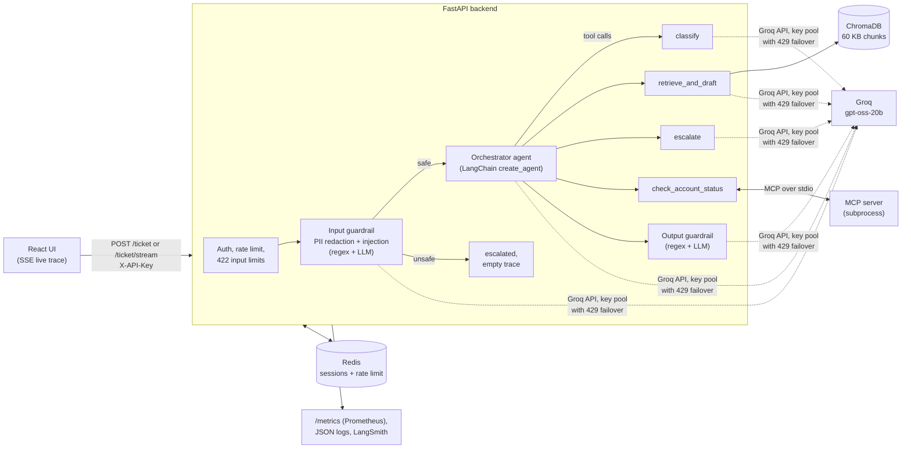

# TriageForge

[](https://github.com/kodebyshubh/triage-agent/actions/workflows/ci.yml)

Agentic support-ticket triage system: ingests a ticket, runs it through an input
guardrail, an Orchestrator agent that genuinely delegates to Classifier /
Retriever+Responder / Escalator tools (plus an account lookup over MCP) via
LangChain tool-calling, then an output guardrail, and returns a structured
`TriageResponse` with a full agent trace.

Built as a portfolio project demonstrating real multi-agent delegation, a guardrail
layer, Pydantic-enforced structured output at every agent boundary, and an eval
harness that every claim below is measured with. Scoped as demo-grade: it runs on
Groq's free tier, and the numbers are from hand-written test sets, not production
traffic.

## Architecture



The orchestrator decides which tool to call from rules in its system prompt and the
tool outputs it sees; there is no `if/else` routing in code. Every tool output is a
validated Pydantic model, and a ticket that cannot be resolved ends in one of four
distinct outcomes (`escalated`, `escalated_due_to_error`, `escalated_output_blocked`,
`escalated_incomplete_lookup`) that are never merged in the metrics.

## Results

Every number here is copied from a saved run output in `eval/`. Routing match means
the final action (auto-resolve vs escalate) matched the ticket's label; "x3" means
each ticket ran three times and the table shows the mean and spread of the per-run
scores.

### Routing accuracy (urgency calibration in `classify()`)

| Run | Test set | Routing match | Source |
|---|---|---|---|
| Baseline, before any changes | original 16 tickets, x1 | 8/16 (50%) | `eval/baseline_before_phase2.txt` |
| Run A, old classifier prompt | 53 tickets, x3 | mean 56.6% (sd 15.0) | `eval/phase2_a_before_fewshot.txt` |
| **Run C, few-shot prompt** | 53 tickets, x3 | **mean 88.1% (sd 1.1, range 86.8 to 88.7)** | `eval/phase2_c_fewshot_v2.txt` |
| Held-out, old prompt | 20 new tickets, x3 | mean 81.7% (sd 2.9) | `eval/phase2_heldout_old_prompt.txt` |
| **Held-out, few-shot prompt** | 20 new tickets, x3 | **mean 91.7% (sd 2.9, range 90 to 95)** | `eval/phase2_heldout_fewshot_v2_merged.txt` |

The few-shot prompt was developed while looking at the 53-ticket set, so the
held-out set is the cleaner generalization number: its 20 tickets were written after
the prompt was frozen and committed (`94b0f3f`, then `eval/heldout_tickets.json`).
`eval/fewshot_overlap_check.py` confirms no few-shot example is a near-duplicate of
any eval or held-out ticket, with thresholds fixed before the first check
(`eval/fewshot_overlap_check_v1.txt` flagged one example, which was replaced:
`eval/fewshot_overlap_check_v2.txt`, `eval/fewshot_overlap_check_v2_with_heldout.txt`).

What changed, by failure mode (pooled over all ticket-runs):

| | Run A | Run C | Held-out old | Held-out few-shot |
|---|---|---|---|---|
| Over-escalation (minor ticket escalated) | 35/159 (22.0%) | 5/159 (3.1%) | 8/60 | 0/60 |
| Under-escalation (urgent ticket auto-resolved) | 9/159 (5.7%) | 12/159 (7.5%) | 3/60 | 5/60 |
| HTTP errors | 25/159 (15.7%) | 1/159 (0.6%) | 0/60 | 0/60 |

The calibration removes tone-driven over-escalation (a frustrated but minor ticket
no longer gets urgency 4 or 5) at the cost of a few more genuinely urgent tickets
being rated too low, for example a legal threat rated urgency 3. Of run A's 25 HTTP
errors, 21 were Groq daily-limit 429s that outlasted the 300 s key wait, 3 were
malformed structured output and 1 was the orchestrator's unrecognized-trace
`RuntimeError` (`eval/errors_before_retry_change.txt`). Because errors count as
misses in routing match, the eval also reports `routing_match_decided`, which
leaves them out of the denominator (A: 67.3%, from the saved run A rows re-scored in
`eval/phase2_a_before_fewshot_reaggregated.txt`; C: 89.2%).

Run history, kept rather than tidied away:
- Run B used the first version of the few-shot prompt (runs 1 and 2: 47/53 and
  45/53, `eval/phase2_b_fewshot.txt`). Its run 3 was aborted on purpose once one
  example was found to be a near-duplicate, and its server was stopped mid-run, so
  run 3 in `eval/phase2_b_fewshot.json` is invalid. Runs 1 and 2 had first been
  rebuilt from the printed tables (`eval/reconstruct_runs_from_table.py`,
  `eval/phase2_b_fewshot_runs1-2_reconstructed.json`) before the original JSON
  turned up; the rebuild matched it with zero field differences.
- `eval/phase2_invalid_rate_limited_run.txt`: an early 53x3 attempt invalidated by
  rate limits (49/159 HTTP errors), not used for any comparison.
- Held-out few-shot run 1 lost 12 of 20 requests to a network outage on this
  machine (`getaddrinfo failed`); kept as `..._run1_network_errors.*`, rerun once, and
  merged with the original runs 2 and 3.

### Model screens (single run, 53 tickets)

| Change | Routing match | Source | Decision |
|---|---|---|---|
| Orchestrator on `qwen/qwen3.8-27b` | 47/53 (88.7%) | `eval/phase2_screen_orch_qwen.txt` | Inside run C's range; not clearly better, not adopted |

Default stays `openai/gpt-oss-20b` for every role. Any role can be switched with
`MODEL_<ROLE>` (`classifier`, `responder`, `escalator`, `orchestrator`, `guardrail`).

### Retrieval (`eval/retrieval_eval_results.txt`, 72 labeled queries)

| Mode | hit@1 | hit@3 | MRR |
|---|---|---|---|
| **Vector (default)** | **86.1%** | **98.6%** | **0.925** |
| Hybrid (BM25 + vector, reciprocal rank fusion) | 73.6% | 88.9% | 0.817 |
| Hybrid + cross-encoder re-rank | 80.6% | 93.1% | 0.867 |

A negative result: on this 60-chunk FAQ knowledge base, hybrid retrieval and
re-ranking both scored below plain vector search, so vector stays the default and
the other two are opt-in (`RETRIEVAL_MODE`). On the 12 keyword-style queries every
mode hits 100%; the gap comes entirely from paraphrased queries. The re-ranker runs
the `ms-marco-MiniLM-L6-v2` cross-encoder through onnxruntime instead of
sentence-transformers: identical scores (max difference 0.00001), 141 ms vs 173 ms
p50 for 10 pairs, 200 MB vs 526 MB resident memory, 1.6 s vs 27.7 s load
(`eval/reranker_cpu_benchmark.txt`).

### Reliability

| Failure mode | Evidence |
|---|---|
| Malformed structured output (`json_validate_failed`, `output_parse_failed`) surfaced as HTTP 500 | 3/441 requests across runs A, B and C (`eval/errors_before_retry_change.txt`); both codes are now retried like `tool_use_failed` |
| Groq free-tier limits (200K tokens per org per model per day) | Key pool with per-(key, model) cooldown and failover on 429; an exhausted pool returns 503 with `Retry-After` instead of 500 |

## Running it

### With Docker

```
cp .env.example .env              # add GROQ_API_KEY (more keys optional)
docker compose up --build
# UI   http://localhost:8080
# API  http://localhost:8000   (docs at /docs, metrics at /metrics)
```

Three containers: backend (FastAPI plus the MCP server as a stdio subprocess in the
same container, non-root user, knowledge base embedded at build time, healthcheck on
`/health`), frontend (static build served by unprivileged nginx) and Redis.
`docker build`, `docker compose up` and `/health` were verified on Docker 29.4.3
(`eval/docker_verification.txt`). Host ports can be changed with `BACKEND_PORT` and
`FRONTEND_PORT`.

### Local development

```
python -m venv venv
venv\Scripts\pip install -r requirements-dev.txt
copy .env.example .env               # add GROQ_API_KEY
venv\Scripts\python -m app.ingest    # embed data/kb/*.md into local ChromaDB
venv\Scripts\python -m uvicorn app.main:app --reload

cd frontend
npm install
npm run dev                          # http://localhost:5173
```

Without `REDIS_URL` sessions live in process memory; without
`TRIAGEFORGE_API_KEYS` auth is off and the rate limit applies per IP. Every setting
is listed in `.env.example`.

### API

| Endpoint | Purpose |
|---|---|
| `POST /ticket` | Triage one ticket, return `TriageResponse` (plus optional `request_id`, `latency_ms`, `token_usage`, `transport_retries`) |
| `POST /ticket/stream` | Same pipeline as Server-Sent Events: each agent step as it completes, then the final response |
| `GET /health` | Liveness |
| `GET /metrics` | Prometheus counters for final actions, transport errors and retries, guardrail flags, rate limits, tokens, and latency histograms |

Errors: 401 missing or wrong `X-API-Key`, 429 over the per-key rate limit, 422 for a
message over `MAX_USER_MESSAGE_CHARS` (default 4000), 503 when the LLM provider's
limits are exhausted.

### Tests and eval

```
venv\Scripts\python -m pytest                       # 134 pass, 1 skipped; every LLM call mocked
venv\Scripts\python -m eval.run_eval --runs 3       # needs a running server
venv\Scripts\python -m eval.retrieval_eval          # offline, no LLM calls
```

CI runs the unit tests on every push and pull request. Run the server with
`CLASSIFY_CACHE_SIZE=0` when evaluating, so repeated runs of a ticket are
independent samples.

## Known Limitations

- **Small, self-written test sets.** 53 + 20 tickets and 72 retrieval queries, all
  hand-written for this project. They compare configurations fairly; they are not a
  benchmark of real support traffic.
- **Under-escalation trade-off.** The urgency calibration that fixed
  over-escalation lets a few urgent tickets through as auto-resolved (7.5% of
  ticket-runs in run C). The orchestrator also occasionally ignores its own
  "urgency 4 or more means escalate" rule.
- **Free-tier rate limits shape everything.** Groq's free tier allows 200K tokens
  per model per day per account; a 53x3 eval needs most of that across several
  keys, and long runs are paced by the limit refilling.
- **Guardrails are heuristics.** Regex PII redaction misses many formats, and the
  injection regex has a known false positive kept in the eval on purpose
  (`adversarial_fp_you_are_now`: "you are now charging me twice").
- **Not deployed.** A Render blueprint (`render.yaml`) and manual steps
  (`docs/DEPLOY_RENDER.md`) are included, but nothing is deployed from this repo.

## MCP Integration

TriageForge also demonstrates tool interoperability across process boundaries via
the [Model Context Protocol](https://modelcontextprotocol.io) (MCP), alongside the
existing in-process LangChain tools (`classify`, `retrieve_and_draft`, `escalate`).
Where those three run as plain Python closures inside the same process as the
orchestrator, the MCP tool runs in a fully separate process, connected over stdio,
demonstrating a genuinely different integration pattern rather than just more of
the same.

`mcp_server/server.py` is a standalone MCP server (built with zero imports from or
dependency on `/app`) exposing one mock tool, `check_account_status(account_id)`,
simulating a CRM/billing lookup against a small hardcoded dataset
(`mcp_server/mock_data.py`) - no real database or external API. The FastAPI backend
connects to it once at startup via a `lifespan` hook (not reconnected per ticket,
to avoid subprocess-spawn latency on every request) and converts its tool into a
LangChain-compatible tool via `langchain-mcp-adapters`, adding it as a 4th tool
alongside the original three. The orchestrator's system prompt gained one new rule:
call `check_account_status` before `retrieve_and_draft` or `escalate` if the ticket
references a specific account.

**The existing 3-tool routing behavior is provably unchanged.** A pre-change
baseline was captured (`eval/baseline_before_mcp.txt`) and compared ticket-for-ticket
against post-wiring runs across the integration: 13/14 and then 12/14 of the
original tickets landed on byte-identical outcomes across separate regression runs,
with every difference individually explained by already-documented model
non-determinism (see Reliability Findings below), not by anything the MCP wiring
itself changed. `eval/test_tickets.json` now has 16 tickets (14 original + 2 added
to specifically exercise `check_account_status`), and `eval/run_eval.py` reports an
additional, additive "account lookup match" metric for those 2 tickets without
altering how the original 4 metrics are computed for the other 14.

Supporting run outputs, kept for evidence rather than summarized away:
`eval/after_mcp_wiring.txt` is the interleaved run that crashed on the
`AccountLookup`-terminal bug below (empty - the process died before writing
any table, which is itself the record of the crash); `eval/after_mcp_final.txt`
is the clean 14-ticket regression run after both fixes; `eval/prompt3_16ticket.txt`
is the full 16-ticket run confirming the eval-set extension didn't disturb the
original 14.

Wiring the MCP tool in did surface one real, separate finding: the model
occasionally calls `check_account_status` and stops, instead of continuing to
`retrieve_and_draft`/`escalate` as intended. Handled the same way as every other
reliability issue in this project - root-caused precisely, not hand-waved: the
system prompt rule was strengthened first (verified via a dedicated frequency test:
0/12 crashes across 3 rounds afterward), and a graceful fallback outcome,
`escalated_incomplete_lookup`, was added as a fourth non-resolution reason
alongside `escalated_due_to_error` and `escalated_output_blocked`, so this failure
mode degrades gracefully instead of crashing the request, and is never silently
miscounted as a routing win or loss.

This is a small, additive demonstration of MCP usage - one mock tool wired in
alongside the existing architecture - not a rebuild of the tool system.

## Reliability Findings

Running the eval set against real Groq models surfaced three distinct, unrelated
failure modes. Each was root-caused with reproducible evidence before any fix was
applied, and each was fixed at the narrowest scope that addressed it - none were
papered over or folded into another outcome.

### 1. Systematic over-escalation (routing bias)

**Baseline: 0/8 correct** on tickets that should auto-resolve via
`retrieve_and_draft` - all 9 were escalated instead, while 5/5 tickets that
should escalate did so correctly. Not random noise: a clean 100%/0% split.

Root cause, found via direct trace inspection: the **classifier**, not the
orchestrator, is the source of the bias. `classify()` reliably assigns
`urgency: 5` to any ticket with frustrated/negative tone - "can you help me sort
it out," "crashes every time," "keep getting a connection timeout error" - even
for objectively minor issues (a duplicate charge, an occasional crash, a
timeout). The orchestrator's routing rule (`escalate` only if `urgency >= 4` or
retrieval `confidence < 0.4`) is then followed correctly given that input. This
is a classifier miscalibration, not a broken orchestration loop - an important
distinction, since it means the delegation architecture itself is sound.

Fix attempts, in order:
- **Prompt tightening alone** (replacing a qualitative escalation rule with a
  mechanical, quantitative one - `urgency >= 4 OR confidence < 0.4`, "never
  escalate as a default/safe choice"): **0/8, no improvement.** Confirmed this
  was a model-capability limit, not a prompt-clarity problem.
- **Scoped model swap**: the orchestrator's tool-selection loop now runs on
  `openai/gpt-oss-20b` (proven reliable at multi-step tool-calling in isolated
  testing) while `classify`/`draft_response`/`escalate` keep using
  `llama-3.1-8b-instant` (proven reliable for structured output). This is the
  fix that moved the number: **3/6 correct (50%)** on tickets that reached a
  genuine routing decision (2/8 separately hit transport errors - see below -
  excluded from this count either way).

Not pursued further: per-call-site model creep or continued prompt engineering
on a small/fast model has diminishing returns. 50%, quantified and root-caused,
is a stronger result than either an unexplained 100% or unbounded time spent
chasing it, given this is explicitly a demo-grade project, not production-grade.

One bounded, time-boxed follow-up experiment: tried `gpt-oss-20b` for `classify()`
alone (isolated, not a global swap) on the 3 tickets that showed inflated
`urgency: 5`. Mixed result, not adopted - 1/3 improved (urgency dropped from 5 to
3, below the escalate threshold), 1/3 unchanged, and 1/3 hit the same
transport-layer glitch (below) in a new call site. Kept `llama-3.1-8b-instant`
for `classify()`, as originally.

**Update:** Groq has since decommissioned `llama-3.1-8b-instant`, so the default
model for `classify`/`draft_response`/`escalate` is now `openai/gpt-oss-20b` too
(with `reasoning_effort="low"` and strict `json_schema` structured output). The
numbers above were measured on the old Llama setup and have not been re-run.

### 2. Transport-layer glitch (malformed tool-call generation)

Groq's models occasionally emit malformed function-call syntax
(`400 tool_use_failed`, e.g. `<function=escalate>{...}` instead of a real tool
call) - a generation-format bug, not a content decision. Confirmed via direct
API error inspection; happens unpredictably in both the orchestrator's own
reasoning and any structured-output call (`classify`/`draft_response`/`escalate`).

Handling: retried up to 2 extra times, scoped **only** to this specific error
(`groq.BadRequestError` containing `tool_use_failed`) - never to a syntactically
valid but disagreeable routing decision, which would quietly substitute engineered
retries for genuine model judgment. When retries are exhausted, the ticket
returns a distinct `final_action: "escalated_due_to_error"` rather than crashing
with a 500 or being counted as a routing win/loss. Still occurs (2/8 in the final
clean eval run) but is now always visible and never silently contaminates the
routing-accuracy number.

One hypothesis tested and disproven: the KB source markdown originally contained
literal double-quotes (e.g. `"Request Refund"`), which could plausibly cause the
model to mis-escape nested quotes when generating structured JSON output. Stripped
all quotes from `data/kb/*.md`, re-ingested, and reran a query that had failed 3/3
times immediately before the change - it failed identically 3/3 times after.
Quote content in the KB is not the trigger; the root cause remains unidentified
generation-format flakiness in the underlying model.

### 3. Output-guardrail false positive

The output moderation LLM check rejected a completely benign, correct
password-reset reply, apparently triggered by a line referencing the KB's
documented verification process ("...contact support with a government ID for
manual verification"). Confirmed reproducible in isolation before any fix.

Fix: added a clarifying example to the guardrail's prompt (a response
referencing a normal, documented support process is not itself a leak). Also
changed the failure behavior: a rejected output now returns a distinct
`final_action: "escalated_output_blocked"` instead of a hard 500 - a real
support system shouldn't crash when it can't safely show a drafted reply, it
should hand off to a human. Retested standalone before rerunning anything
broader: guardrail now passes the exact response that previously failed.
After the fix: 0/8 output-blocks in the clean eval rerun, and the ticket that
originally crashed on this now resolves correctly end-to-end.

### 4. Injection-classifier false positive

The LLM injection check flagged a legitimate PII-containing refund request
(`"my email is john@example.com... please refund me"`) as also being a
prompt-injection attempt, purely because it contained personal information.

Fix: added a clarifying negative example to the injection-check prompt (PII
alone is not injection). Retested: the previously-flagged ticket is no longer
rejected by the guardrail. True-positive detection is unaffected - a genuine
injection attempt in the eval set is still caught and rejected correctly.

### Summary

| Failure mode | Before | After |
|---|---|---|
| Routing bias (over-escalation) | 0/8 correct | 3/6 correct (50%) on genuine decisions |
| Transport glitch (malformed generation) | Crashed the request (500) | Isolated as `escalated_due_to_error`, never silently miscounted |
| Output-guardrail false positive | Crashed the request (500) | 0/8 blocks; affected ticket now resolves correctly |
| Injection-classifier false positive | Rejected a legitimate request | No longer rejected; true positives still caught |

All three non-resolution outcomes (`escalated`, `escalated_due_to_error`,
`escalated_output_blocked`) are kept distinct in the schema and the eval script
specifically so that conflating any pair of them can't hide which failure mode is
actually responsible for a given ticket's outcome.

### Known verification gap

`escalated_output_blocked` is confirmed working at the data/backend layer - the
guardrail fix was retested standalone against the exact string that originally
triggered it, and `main.py`'s handling of a rejected output was verified by
calling it directly. One attempt was made to trigger it end-to-end through the
live UI (a ticket asking the model to reveal its system prompt), but that
message was - correctly - caught by the *input* guardrail's injection heuristic
first, so it never reached the output-guardrail path. The rendered UI state for
`escalated_output_blocked` (the red badge/card branch in `ResultCard`) has not
been visually confirmed in a browser, since manufacturing a genuine trigger
without a live browser session proved unreliable. Session-memory context
carrying across a two-turn conversation, by contrast, **was** confirmed live:
a follow-up message containing none of the original ticket's keywords still
produced a response referencing the original topic, which can only happen via
the injected history context.
